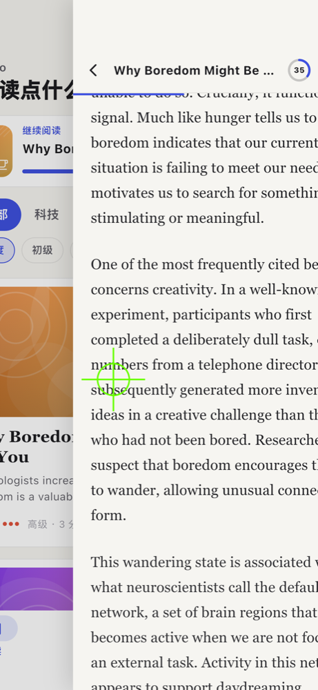
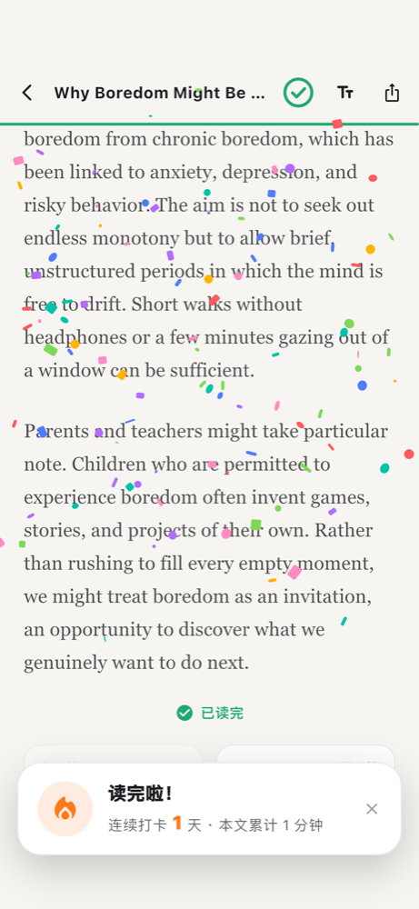

# English Reader

离线优先的英语阅读学习 App。Flutter 实现，数据全部落在本地 SQLite，飞行模式下可以完成
「列表 → 阅读 → 长按取词收藏 → 进度落库」全链路。

> 跨平台 App 工程师（数据分析方向）技术评估作业。数据层选的是题目允许的方案 ①：
> 内置种子数据 + 本地 SQLite，不建后端；同步与冲突策略在[第 6 节](#6-离线优先与数据一致性)给出设计。

## 目录

1. [功能对照](#1-功能对照)
2. [技术选型与理由](#2-技术选型与理由)
3. [本地启动](#3-本地启动)
4. [架构说明](#4-架构说明)
5. [本地数据库](#5-本地数据库)
6. [离线优先与数据一致性](#6-离线优先与数据一致性)
7. [Mock 鉴权的校验方式](#7-mock-鉴权的校验方式)
8. [动效清单](#8-动效清单)
9. [三个技术难点](#9-三个技术难点)
10. [帧率验证](#10-帧率验证)
11. [数据埋点方案](#11-数据埋点方案)
12. [工程化](#12-工程化)
13. [打包、签名与上架](#13-打包签名与上架)
14. [已知缺陷与优化思路](#14-已知缺陷与优化思路)
15. [演示素材](#15-演示素材)

---

## 1. 功能对照

| 题目要求 | 实现 | 代码位置 |
|---|---|---|
| 登录 / 注册、Token 鉴权、登录态持久化 | 本地 Mock 账号 + 签名 Token，重启恢复 | `lib/data/auth_service.dart` |
| 文章列表：分类、难度、下拉刷新、分页、骨架屏 | 4 个分类 + 3 档难度，每页 8 篇按需构建 | `lib/features/articles/` |
| 阅读：字号、行距、主题、上下篇 | 字号 15–26、行距 1.4–2.1、日间 / 护眼 / 夜间 | `lib/features/reader/` |
| 阅读进度：位置、完成状态、累计时长、精确恢复 | 段落序号 + 段内比例，改字号后仍指向同一句话 | `lib/domain/reading_math.dart` |
| 生词本：长按取词、查看、删除、跳回原文 | 取词即查 Mock 词表，生词记录段落与词序号 | `lib/features/reader/paragraph_view.dart`、`lib/features/vocabulary/` |
| 离线优先：SQLite 建表、种子导入 | 首次启动导入 24 篇文章 + 1973 个词条 | `lib/core/db/` |
| 数据一致性：幂等、杀进程不丢 | 绝对值快照写入 + WAL，最多丢 0.8 秒 | `lib/data/progress_repository.dart` |
| 动效 4 项 | 全部完成，见[第 8 节](#8-动效清单) | `lib/motion/` |
| 埋点方案（加分） | 事件模型、队列、退避重试、调试面板、3 个查询 | `lib/analytics/` |
| Git + CI | GitHub Actions：格式、静态分析、单测 | `.github/workflows/ci.yml` |

没有做的加分项：小程序 / H5、推送与每日提醒、全文搜索、LLM 接入。

## 2. 技术选型与理由

| 层 | 选择 | 理由 |
|---|---|---|
| 跨端框架 | Flutter 3.50（Dart 3.14） | 自绘引擎，动效在 iOS / Android 上逐像素一致；手势、物理模拟、CustomPainter 都是一等公民，适合「手感」要求高的题目 |
| 本地存储 | `sqflite`，手写 SQL | 题目要求给出建表 SQL 与迁移策略；手写 SQL 可以精确控制索引和幂等写法，面试时每一句都讲得清 |
| KV | SQLite 里的 `meta` 表 | 只有 3 个阅读设置 + 种子版本 + 设备 ID，不值得再引入一个原生 KV 插件 |
| 安全存储 | `flutter_secure_storage` | Token 与签名密钥放 Keychain / Keystore，不落明文 |
| 状态管理 | 不引入框架：仓储 + `ValueNotifier` + 一个依赖容器 | SQLite 是唯一真相源，页面直接查库；仓储在数据变化时发通知，页面重查。App 规模下比引入 Riverpod / Bloc 更少的间接层 |
| 动效 | 框架原生能力：`AnimationController`、`SpringSimulation`、`Hero`、`CustomPainter`、`Ticker` | 核心动效全部自己编排，没有用 Lottie / Rive，也没有用动效库 |
| 测试 | `flutter_test` + `sqflite_common_ffi` | 单测直接跑真实 SQLite，执行的是和 App 完全相同的建表脚本 |

三方运行时依赖只有 4 个：`sqflite`、`path`、`flutter_secure_storage`、`crypto`。

## 3. 本地启动

### 环境

- Flutter 3.50.x（`flutter --version` 确认）
- iOS：Xcode 16.2 及以上 + CocoaPods；Android：Android SDK + JDK 17
- 国内网络建议先设置镜像：

```bash
export PUB_HOSTED_URL=https://pub.flutter-io.cn
export FLUTTER_STORAGE_BASE_URL=https://storage.flutter-io.cn
```

### 运行

```bash
flutter pub get
flutter devices                 # 查看可用设备
flutter run -d <设备 ID>         # 模拟器 / 真机，debug 模式
flutter run -d <设备 ID> --profile   # 真机性能模式（看帧率用这个；iOS 模拟器不支持）
```

- **不需要后端、不需要手动导入数据**：首次启动会在一个事务里把 `assets/seed/` 下的文章和词表导入 SQLite。
- **演示账号**：`demo` / `demo1234`（登录页点「填入演示账号」）。也可以自己注册。
- 可选参数：
  - `--dart-define=ANALYTICS_ENDPOINT=https://example.com/collect`：埋点改为真实 HTTP 上报（默认是本地 Mock 接收端）。
  - `--dart-define=PERF_OVERLAY=true`：显示 Flutter 性能浮层。

### 测试

```bash
flutter analyze                 # 静态分析
flutter test                    # 52 个单元测试
tool/analytics_report.sh        # 对模拟器里的 App 数据库跑埋点分析查询

# 端到端主链路（会自动截图到 build/screenshots/）
flutter drive --driver=test_driver/integration_test.dart \
  --target=integration_test/app_flow_test.dart -d <设备 ID>
```

## 4. 架构说明

```
┌──────────────────────────────────────────────────────────────┐
│ features/   页面：auth · articles · reader · vocabulary       │
│             · profile · debug                                 │
│ motion/     动效组件（路由、入场、微光、进度环、彩纸…）          │
├──────────────────────────────────────────────────────────────┤
│ domain/     纯逻辑，无 Flutter / 无 IO：                        │
│             分词 · 阅读位置换算 · 有效时长计时 · 打卡           │
│ analytics/  埋点：事件模型 · 队列 · 上报器 · 会话 · 曝光 · 查询   │
├──────────────────────────────────────────────────────────────┤
│ data/       仓储：每张表一个，封装全部 SQL                      │
├──────────────────────────────────────────────────────────────┤
│ core/db/    开库 · 迁移 · 种子导入                             │
│             SQLite（WAL）                                     │
└──────────────────────────────────────────────────────────────┘
```

- **依赖方向单向向下**。`domain/` 不依赖 Flutter，所以阅读位置、计时、打卡这些核心算法都能用纯单测覆盖。
- **状态**：`AppScope`（`lib/app/app_scope.dart`）在冷启动时组装所有仓储和服务。页面直接查仓储；
  `ProgressRepository.revision`、`VocabRepository.revision` 在数据变化时自增，监听它的页面重新查询。
  例如从阅读页返回后，列表卡片上的进度环会自己补间到新值。
- **冷启动顺序**：开库并迁移 → 导入种子（仅首次）→ 词表读入内存 → 校验 Token 恢复登录态 →
  探测网络 → 记录 `app_open` → 上报器补报上次遗留的事件。

### 数据流

```
用户滚动
  → ReaderPage 计算进度与阅读位置（domain/reading_math.dart）
  → 节流 800ms 生成一份「绝对值快照」
  → ProgressRepository.save（一个事务：reading_progress + reading_sessions）
  → revision++ → 列表页 / 个人页重查并补间到新值

用户行为
  → Analytics.track（补公共参数，写入 event_queue，立即返回）
  → EventUploader（定时 / 满 20 条 / 切后台 / 冷启动）取批上报
  → 成功：标记已上报；失败：指数退避后重试
```

## 5. 本地数据库

完整建表脚本在 [`lib/core/db/migrations.dart`](lib/core/db/migrations.dart)，下面是核心表。

```sql
-- 文章（种子导入）
CREATE TABLE articles (
  id           TEXT PRIMARY KEY,
  title        TEXT NOT NULL,
  title_zh     TEXT NOT NULL DEFAULT '',
  category     TEXT NOT NULL,              -- tech / business / culture / daily
  difficulty   INTEGER NOT NULL,           -- 1 初级 2 中级 3 高级
  author       TEXT NOT NULL DEFAULT '',
  published_at TEXT NOT NULL,              -- yyyy-MM-dd
  summary      TEXT NOT NULL DEFAULT '',
  body_json    TEXT NOT NULL,              -- 段落数组
  word_count   INTEGER NOT NULL DEFAULT 0,
  version      INTEGER NOT NULL DEFAULT 1,
  updated_at   INTEGER NOT NULL
);

-- 阅读进度：每个用户每篇文章一行
CREATE TABLE reading_progress (
  user_id          TEXT NOT NULL,
  article_id       TEXT NOT NULL REFERENCES articles(id),
  paragraph_index  INTEGER NOT NULL DEFAULT 0,  -- 读到第几段
  paragraph_offset REAL NOT NULL DEFAULT 0,     -- 段内纵向比例 0~1
  progress         REAL NOT NULL DEFAULT 0,     -- 当前滚动进度
  max_progress     REAL NOT NULL DEFAULT 0,     -- 最远进度，只增不减
  completed        INTEGER NOT NULL DEFAULT 0,
  completed_at     INTEGER,
  duration_ms      INTEGER NOT NULL DEFAULT 0,  -- 累计有效阅读时长
  last_read_at     INTEGER NOT NULL,
  version          INTEGER NOT NULL DEFAULT 1,
  updated_at       INTEGER NOT NULL,
  PRIMARY KEY (user_id, article_id)
);

-- 阅读会话：进入一次阅读页为一行，用于按天统计与打卡
CREATE TABLE reading_sessions (
  id          TEXT PRIMARY KEY,
  user_id     TEXT NOT NULL,
  article_id  TEXT NOT NULL,
  day         TEXT NOT NULL,                    -- 本地日期
  started_at  INTEGER NOT NULL,
  duration_ms INTEGER NOT NULL DEFAULT 0
);

-- 生词本：同一用户同一词元只收藏一次，记录首次出处
CREATE TABLE vocabulary (
  id              TEXT PRIMARY KEY,
  user_id         TEXT NOT NULL,
  word            TEXT NOT NULL,                -- 词元（小写）
  display         TEXT NOT NULL,                -- 原文中的写法
  phonetic        TEXT NOT NULL DEFAULT '',
  pos             TEXT NOT NULL DEFAULT '',
  meaning         TEXT NOT NULL DEFAULT '',
  article_id      TEXT NOT NULL,                -- 出处：文章
  paragraph_index INTEGER NOT NULL,             -- 出处：第几段
  word_index      INTEGER NOT NULL,             -- 出处：段内第几个词
  context         TEXT NOT NULL DEFAULT '',     -- 所在句子
  created_at      INTEGER NOT NULL,
  version         INTEGER NOT NULL DEFAULT 1,
  updated_at      INTEGER NOT NULL,
  UNIQUE (user_id, word)
);

-- 埋点事件队列。status：0 待上报 1 上报中 2 已上报
CREATE TABLE event_queue (
  event_id      TEXT PRIMARY KEY,               -- UUID，去重键
  name          TEXT NOT NULL,
  ts            INTEGER NOT NULL,
  session_id    TEXT NOT NULL,
  user_id       TEXT NOT NULL DEFAULT '',
  payload_json  TEXT NOT NULL,                  -- 公共参数 + props
  status        INTEGER NOT NULL DEFAULT 0,
  attempts      INTEGER NOT NULL DEFAULT 0,
  next_retry_at INTEGER NOT NULL DEFAULT 0,
  batch_id      TEXT,
  sent_at       INTEGER,
  last_error    TEXT
);
```

其余表：`users`、`sessions`（Mock 鉴权）、`dictionary`、`dictionary_forms`（Mock 词表与词形还原）、
`upload_log`（上报结果）、`mock_server_events`（扮演服务端）、`meta`（键值）。

### 表关系

```
users 1 ── n sessions
users 1 ── n reading_progress n ── 1 articles
users 1 ── n reading_sessions n ── 1 articles
users 1 ── n vocabulary       n ── 1 articles     （生词 → 原文出处）
dictionary 1 ── n dictionary_forms                （running → run）
event_queue 独立；upload_log 按 batch_id 关联一次上报
```

### 索引

| 索引 | 服务的查询 |
|---|---|
| `articles(category, published_at DESC, id)` | 列表按分类筛选 + 发布时间倒序分页 |
| `articles(published_at DESC, id)` | 「全部」分类分页、上一篇 / 下一篇 |
| `articles(difficulty)` | 难度筛选 |
| `reading_progress(user_id, last_read_at DESC)` | 「继续阅读」 |
| `reading_sessions(user_id, day)` | 近 7 日时长、打卡天数 |
| `vocabulary(user_id, created_at DESC)` | 生词本列表 |
| `event_queue(status, next_retry_at, ts)` | 上报器取批：待上报且到达重试时间，按时间先后 |
| `event_queue(name, ts)` | 分析查询：按事件名 + 时间窗口 |

### 迁移策略

- 版本号存在 `PRAGMA user_version`。打开数据库时，依次执行 `kMigrations` 中「当前版本 + 1」到「目标版本」的脚本。
- 整个升级在一个事务里，任何一句失败就整体回滚，版本号不前进，下次启动重试。
- 约定：已发布的脚本只增不改，改表一律追加新版本号。
- 单测 `升级：只执行尚未执行的版本，旧数据保留` 覆盖了 v1 → v2 的路径。

## 6. 离线优先与数据一致性

### 幂等写入

阅读页每次落库写的是一份**绝对值快照**（位置、进度、累计时长），不是增量：

```sql
UPDATE reading_progress SET
  paragraph_index = ?, paragraph_offset = ?, progress = ?,
  max_progress = MAX(max_progress, ?),          -- 最远进度不回退
  completed    = MAX(completed, ?),             -- 完成状态不回退
  completed_at = COALESCE(completed_at, ?),     -- 首次读完时间不被覆盖
  duration_ms  = MAX(duration_ms, ?),           -- 时长是绝对值，重复写不累加
  last_read_at = MAX(last_read_at, ?),
  version = version + 1, updated_at = ?
WHERE user_id = ? AND article_id = ?;
-- 没有命中行时再 INSERT，两步在同一个事务里
```

同一份快照写 1 次和写 N 次结果相同，所以节流落库、切后台落库、离开页面落库可以放心重叠触发。
没用 `INSERT ... ON CONFLICT DO UPDATE` 是因为 Android 9 及以下系统自带的 SQLite 早于 3.24，不支持这个语法。

其它写入同样幂等：生词靠 `UNIQUE(user_id, word)`，事件靠 `event_id` 主键，种子导入按主键 `REPLACE`。

### 进程被杀不丢进度

- 滚动时每 800ms 落库一次，另有 5 秒一次的心跳落库（不滚动时时长也在增长）。
- App 切后台时立即落库。
- 数据库开 WAL 模式，已提交的事务在进程被杀后仍然完整。
- 结论：任意时刻杀进程，最多丢失最近 0.8 秒的滚动位置。

### 如果接后端：同步与冲突策略（设计，未实现）

表里已经预留了 `version` 和 `updated_at`：

- **上行**：本地改动写入一张变更日志表（与 `event_queue` 同构），由同一套「取批 → 上报 → 退避重试」机制发送，服务端按变更 ID 去重。
- **阅读进度的冲突**：按字段合并而不是整行覆盖。`max_progress`、`completed`、`duration_ms` 取两端较大值（天然可交换、可重放）；
  当前位置 `paragraph_index / paragraph_offset` 用 last-write-wins，以 `last_read_at` 较新的一端为准。
- **生词本的冲突**：集合语义，新增取并集；删除记墓碑（`deleted_at`），与新增比较时间戳。
- **文章**：只读数据，按服务端 `version` 单向下行覆盖。

## 7. Mock 鉴权的校验方式

- **账号**：存 `users` 表。密码是「16 字节随机盐 + SHA-256 迭代 2000 轮」，不存明文。
- **Token**：`base64url(payload) . base64url(HMAC-SHA256(payload, secret))`，结构同 JWT。
  payload 含 `sub`（用户 ID）、`jti`（会话 ID）、`iat`、`exp`（30 天）。
  `secret` 是安装时随机生成的 32 字节，和 Token 一起存 Keychain / Keystore。
- **校验**（冷启动恢复登录态时执行）四项全过才算有效：
  1. 签名正确（常数时间比较）；
  2. 未过期；
  3. `sessions` 表存在该 `jti` 且未吊销；
  4. 用户存在。
- **登出**：吊销 `jti` 并删除本地 Token，旧 Token 立即失效。

单测覆盖：重启恢复、Token 被篡改、过期、登出后失效、错误密码、重复注册。

## 8. 动效清单

所有动效参数集中在 [`lib/motion/motion.dart`](lib/motion/motion.dart)。
弹簧的阻尼比 ζ = damping / (2·√(stiffness·mass))：ζ < 1 有回弹，ζ = 1 刚好不回弹。

| 弹簧 | mass / stiffness / damping | ζ | 用在哪 |
|---|---|---|---|
| `snappy` | 1 / 420 / 34 | 0.83 | 跟手交互的收尾：返回手势取消回弹 |
| `bouncy` | 1 / 380 / 18 | 0.46 | 强调型反馈：取词气泡、庆祝卡片 |
| `gentle` | 1 / 200 / 25 | 0.88 | 大面积元素落定：卡片按压回弹 |

### 第 1 项：转场与共享元素（必做）

| 动效 | 页面 | 方案 | 关键参数 |
|---|---|---|---|
| 封面共享元素 | 列表卡片 → 阅读页头图 | `Hero` + 自定义 `flightShuttleBuilder` | 直线飞行；圆角 14 → 0 随进度插值；封面是矢量绘制，放大不糊 |
| 标题共享元素 | 同上 | `Hero`，飞行中不重排文字 | 两端排版各自冻结后按宽度整体缩放叠放，列表侧 0–45% 淡出，详情侧 20–70% 淡入 |
| 页面转场 | 全局 | 自定义 `PageRoute` | 进入 460ms、返回 380ms，`fastEaseInToSlowEaseOut`；下层页面视差左移 25% 并压暗 16% |
| 跟手右滑返回 | 阅读页、调试面板 | 自己的手势识别 + 直接改写路由动画进度 | 全屏宽度可发起；松手速度 ≥ 1 屏宽 / 秒看方向，否则看是否过半；取消用 `snappy` 弹簧带松手速度回弹 |

### 第 2 项：内容入场（必做）

| 动效 | 页面 | 方案 | 关键参数 |
|---|---|---|---|
| 列表交错入场 | 文章列表、生词本 | `StaggerController` + `EntranceItem` | 每项延迟 55ms（最多 10 级），420ms `easeOutCubic`，淡入 + 上移 22px |
| 正文首屏入场 | 阅读页 | 单个控制器驱动多个区块 | 转场开始 160ms 后启动，每块延迟 70ms，340ms，淡入 + 上移 18px |
| 登录页、个人页入场 | 登录、我的 | `EntranceItem` | 每块延迟 60–70ms |

交错入场的两个细节：延迟是「该项应有的延迟 − 本轮已过去的时间」，所以滚动后才构建的卡片不会排队等；
已入场的卡片被回收后再次滚入视口不会重播。

### 第 3 项：状态与进度

| 动效 | 页面 | 方案 | 关键参数 |
|---|---|---|---|
| 阅读进度条 | 阅读页顶栏下沿 | 宽度 = 滚动进度，逐帧跟随 | 无补间，所以不滞后 |
| 阅读进度环 | 阅读页顶栏 | `CustomPainter`，滚动位置直接驱动 | 读完后闭合，520ms 描出对勾 |
| 卡片进度环 | 文章列表 | `TweenAnimationBuilder` | 数值变化时 600ms `easeOutCubic` 推进 |
| 读完庆祝：彩纸 | 阅读页 | 自绘粒子系统，一个 `Ticker` + 一个 `CustomPainter` | 110 片，初速度 900–1700 px/s，重力 1500 px/s²，阻力每秒保留 28% 速度，3.2 秒 |
| 读完庆祝：打卡卡片 | 阅读页 | `bouncy` 弹簧上滑 + 数字滚动 | 连续打卡天数 800ms 从 0 滚到目标值，重触感一次 |
| 统计数字滚动、柱状图生长 | 我的 | `TweenAnimationBuilder` | 700ms；柱子依次延迟 60ms |

### 第 4 项：微交互

| 动效 | 页面 | 方案 | 关键参数 |
|---|---|---|---|
| 收藏按钮形变弹跳 | 取词气泡 | 620ms 编排：压扁 → 拉长 → `elasticOut` 落定，外加 8 颗放射粒子和扩散圆环 | scaleX 1 → 1.25 → 0.82 → 1；scaleY 1 → 0.70 → 1.32 → 1 |
| Tab 指示器滑动 | 文章列表 | 实测每个 Tab 位置，自绘胶囊；文字按胶囊覆盖范围反色（裁剪一层反色文字） | 360ms；前缘 0–65% 先走、后缘 35–100% 后走，中途被拉长 |
| 骨架屏微光 | 文章列表 | 整块骨架共用一个 `ShaderMask` | 1.3 秒一个周期，高光带倾斜扫过 |
| 取词气泡弹出 | 阅读页 | `bouncy` 弹簧缩放 0.82 → 1 | 以贴近单词的那条边为缩放原点 |
| 按压反馈 | 卡片、按钮 | 按下 90ms 缩到 0.97，松开 `gentle` 弹簧回弹 | |
| 表单错误抖动 | 登录页 | 衰减正弦 | 420ms，幅度 10px，5 个半周期 |
| 主题切换 | 全局 | `ThemeExtension.lerp` | 全局颜色 260ms 补间 |

### 如何验证每个动效

端到端测试 `integration_test/app_flow_test.dart` 会依次触发上面的主要动效，并在动画中途截图
（Tab 指示器滑动中、封面飞行中、手势返回拖动中、收藏按钮弹跳中、彩纸飘落中），
截图见[第 15 节](#15-演示素材)。帧率的验证方法见[第 10 节](#10-帧率验证)。

## 9. 三个技术难点

### 9.1 退出重进，精确恢复阅读位置

**不存像素，存「第几段 + 段内纵向比例」。**
像素偏移在改字号、改行距、换设备后就失效了；「第 3 段的 37% 处」始终指向同一句话。

1. 正文所有段落一次布局完成（文章几百词，没必要懒加载），布局后实测每个段落槽位（段落 + 段后间距）的 `top` 和 `height`。
   量的是入场动效 `Transform` 之外的槽位：最初直接量段落，测量发生在入场动画途中，位置被带偏了 18px，
   这个问题是端到端测试里「字号改回去后偏移应还原」的断言发现的。
2. 滚动时，取「视口顶部阅读线」所在的 y，换算成 `(段落序号, 段内比例)` 落库。
3. 重进时等转场结束，把保存的位置换算回当前排版下的像素偏移，520ms 滚动过去，最后 `jumpTo` 精确落位。
4. 改字号 / 行距时：先记下当前位置 → 重排 → 重新测量 → 跳回同一位置，读到哪句还在哪句。

端到端测试里验证了两点：重进后滚动偏移与离开时相差不超过 1 像素；字号 +4 再还原后偏移回到原值。
换算逻辑是纯函数，在 `test/domain_test.dart` 里单独覆盖。

### 9.2 长按取词

**整段只有一个 `RichText`，不是每个单词一个 Widget。**

1. 段落预先分词（`lib/domain/tokenizer.dart`），每个词有字符区间和「段内词序号」。
2. 长按时：手指位置 → `RenderParagraph.getPositionForOffset` 得到字符偏移 → 二分查到所属单词。
3. `getBoxesForSelection` 取这个词的包围盒，并校验手指确实落在盒内（否则行尾空白也会吸附到最近的词）。
4. 包围盒交给 `CustomPainter` 画在文字下层作为高亮；换词只重绘这一段，不触发文本重排。
5. 长按不抬手继续拖，可以连续换词，每换一个词给一次轻触感。长按阈值设为 350ms（系统默认 500ms）。

词表（1973 词条 + 868 个词形映射）启动时读入内存，取词是同步查找，拖动换词没有等待。
单测 `seed_data_test.dart` 校验了内置文章里的每一个词都能查到释义。

生词记录 `(文章 ID, 段落序号, 词序号)`，这三个值与排版无关，所以「跳回原文」在任何字号下都能定位并闪烁高亮。

### 9.3 跟手返回与共享元素联动

`Hero` 默认只在普通的 push / pop 时飞行。要让它跟着手指走：

1. 手势被判定为横向拖动后调用 `navigator.didStartUserGesture()`，`HeroController` 据此启动一次由手势驱动的飞行
   （两端的 `Hero` 需要 `transitionOnUserGestures: true`）。
2. 拖动时直接改写路由的 `AnimationController.value`。页面位移、下层视差、遮罩、Hero 飞行都由这一个值驱动，天然同步。
3. 手势期间进度到位移必须线性映射，否则页面和手指对不上；非手势转场才套缓动曲线。
4. 松手后：取消则带着松手速度用弹簧回到 1；完成则先 `pop()`，再按剩余距离和松手速度算收尾时长。
5. 封面滚出屏幕后用 `HeroMode` 关闭共享元素，否则返回时封面会从屏幕外飞回卡片。

手势识别器加入手势竞技场，与纵向滚动、长按取词公平竞争：横向位移先超过阈值才胜出，不影响上下滚动。

## 10. 帧率验证

### 设计上怎么保证不丢帧

- 入场、按压、转场只动 `Opacity` 和 `Transform`，不触发布局。
- 彩纸、进度环、Tab 指示器、取词高亮都是 `CustomPainter`：每帧一次绘制，没有 Widget 重建。
- 骨架屏整块只有一个 `ShaderMask`，不是每个占位块一个。
- 阅读页顶栏用 `AnimatedBuilder` 局部重建，滚动时正文不重建。
- 列表按需构建；封面是矢量绘制并包了 `RepaintBoundary`，不解码图片。
- 埋点和进度落库全部异步，不占用 UI 线程。

### 怎么测

**方式一：App 内调试面板**（我的 → 埋点与性能调试面板 → 帧耗时）。
数据来自引擎的 `FrameTiming`（与 DevTools 同源），显示 build / raster 平均耗时、P90、P99、最差帧、超预算帧数。
操作前点「清零」，做完动作回来看结果；右上角按钮可以把结果复制出来。

**方式二：端到端测试自动采集**。测试里用 `watchPerformance` 包住了 5 个场景
（列表滚动、共享元素转场、手势返回、阅读滚动 + 读完庆祝），结果写入 `build/integration_response_data.json`：

```bash
flutter drive --profile --driver=test_driver/integration_test.dart \
  --target=integration_test/app_flow_test.dart -d <真机 ID>
```

### 现有数据与限制

帧率数据只有在**真机 + profile 模式**下才有意义：debug 模式带断言且是 JIT 执行，iOS 模拟器又不支持 profile 模式。
本仓库的开发与验证是在 iOS 模拟器（debug）上完成的，所以这里**没有可以作为结论的真机帧率数据**；
上面两种方式在真机上各跑一次即可得到，录屏时建议同时打开 `--dart-define=PERF_OVERLAY=true`。

下面是端到端测试在模拟器 debug 模式下采到的 **UI 线程（build）耗时**，只能当作「Dart 侧没有明显的重活」的弱信号：

| 场景 | 帧数 | build 平均 | build P90 | build P99 |
|---|---|---|---|---|
| 列表快速滚动 | 230 | 2.0 ms | 4.1 ms | 17.1 ms |
| 跟手右滑返回 | 71 | 1.3 ms | 2.8 ms | 7.2 ms |
| 阅读滚动 + 读完庆祝 | 220 | 3.7 ms | 8.5 ms | 18.5 ms |
| 共享元素转场 | 26 | 17.0 ms | 43.0 ms | 193.3 ms |

说明：环境是 Intel Mac 上的 iPhone 16 模拟器（iOS 18.3）。「共享元素转场」那一段里包含一次动画中途截图和阅读页首次构建，
数值被它们拉高。同一次采集里光栅线程平均 15–30 ms，这反映的是模拟器的软件渲染开销，不代表真机，所以没有列入。

## 11. 数据埋点方案

### 11.1 事件模型

**命名规范**：`对象_动作`，全小写下划线。新事件必须先在
[`lib/analytics/event_schema.dart`](lib/analytics/event_schema.dart) 登记；
debug 模式下 `track` 会校验「缺必填参数」和「传了未登记的参数」并打印警告，单测会校验所有事件名符合规范。

**公共参数**（每条事件自动带上，业务代码不传）：

| 参数 | 含义 |
|---|---|
| `event_id` | UUID，去重键 |
| `event` | 事件名 |
| `ts` | 事件发生时间（客户端毫秒时间戳） |
| `device_id` | 安装级设备标识（首次启动生成，存 `meta` 表） |
| `user_id` | 登录用户 ID，未登录为空串 |
| `session_id` | 会话 ID |
| `app_version` | App 版本 |
| `platform` | `ios` / `android` |
| `network` | 事件发生时的联网状态：`online` / `offline` |

**事件与业务参数**：

| 事件 | 触发位置 | 必填参数 | 选填参数 |
|---|---|---|---|
| `app_open` | 冷启动；后台超过 30 秒后回到前台 | `launch_type` | `background_ms` |
| `session_start` | 新会话开始 | `reason` | |
| `page_view` | 进入页面、切换底部 Tab | `page` | `from`、`article_id` |
| `user_login` | 登录 / 注册成功 | `method` | |
| `list_refresh` | 列表下拉刷新 | | `category`、`difficulty` |
| `category_switch` | 分类 / 难度筛选切换 | `filter_type`、`to` | `from` |
| `article_expose` | 列表卡片曝光 | `article_id`、`position` | `category`、`difficulty`、`list_category` |
| `article_open` | 打开文章 | `article_id`、`source` | `category`、`difficulty`、`resume_progress` |
| `read_progress` | 滚动深度首次跨过 25 / 50 / 75 / 100 | `article_id`、`depth` | |
| `read_duration` | 离开阅读页或切后台 | `article_id`、`duration_ms`、`max_depth` | `reason` |
| `article_finish` | 首次读完 | `article_id`、`total_duration_ms` | `streak_days`、`category`、`difficulty` |
| `word_lookup` | 长按取词（松手时） | `article_id`、`word` | `found`、`paragraph_index` |
| `word_collect` | 收藏生词 | `article_id`、`word` | `paragraph_index`、`source` |
| `word_remove` | 取消收藏 / 删除生词 | `word` | `source`、`article_id` |
| `article_share` | 分享文章 | `article_id` | `channel` |
| `offline_hit` | 无网络时从本地库成功提供列表或文章 | `resource` | `article_id` |
| `reader_setting_change` | 调整字号 / 行距 / 主题 | `key`、`value` | |

题目要求覆盖的 10 个位置（打开 App、列表曝光、分类切换、文章打开、阅读时长与滚动深度、取词、收藏、读完、分享、离线命中）都在表中。

### 11.2 上报策略

```
track()
  └─ 写入 event_queue（status = 待上报），立即返回，不发网络、不等待

EventUploader
  触发：冷启动 · 每 30 秒 · 待上报满 20 条 · 切后台 · 调试面板手动
  ├─ 取批：一个事务内取最多 20 条到期事件并标记「上报中」
  ├─ 成功：标记「已上报」，记 upload_log
  └─ 失败：退回「待上报」，attempts + 1，写入下次重试时间，本轮停止
```

- **失败退避**：第 n 次失败后等待 5s × 2^(n−1)，封顶 10 分钟，再乘 0.8–1.2 的随机抖动。即 5s → 10s → 20s → 40s → … → 10min。
- **离线缓存**：离线时上报失败，事件留在表里；`track` 本身不依赖网络，离线期间照常记录。
- **冷启动补报**：启动时先把上次进程被杀时卡在「上报中」的事件退回「待上报」，然后立即上报。
- **幂等**：客户端 `event_id` 主键防重复入队；上一条里被重发的事件服务端可能已经收到过，由服务端按 `event_id` 去重
  （Mock 接收端实现了这一点，单测 `冷启动补报` 验证重发后服务端没有重复数据）。
- **不阻塞 UI**：入队和上报全部异步；已上报事件保留 30 天供本地查询，之后清理。

### 11.3 统计口径

| 指标 | 口径 |
|---|---|
| 会话 | 冷启动开启新会话；App 进入后台超过 30 秒后回到前台算新会话，不足 30 秒沿用原会话 |
| 阅读时长 | 只计「阅读页在前台可见」且「最近 60 秒内有滚动或触摸」的时间。放着不动超过 60 秒，超出部分不计；后台时间不计 |
| 滚动深度 | 滚动偏移 ÷ 可滚动总长。达到 97% 视为读完（留出底部回弹和「下一篇」卡片的余量） |
| 曝光 | 卡片可见面积 ≥ 50% 且连续停留 ≥ 500ms；同一会话内同一篇文章只报一次。快速划过不算 |
| 打卡日 | 当天累计有效阅读 ≥ 30 秒，或当天读完过文章 |
| 连续打卡 | 从今天往前数连续的打卡日；今天还没读时从昨天开始数，不清零 |

阅读时长的计时器、会话切分、打卡计算都是纯逻辑类，单测逐条覆盖了上面的边界。

### 11.4 如何验证

**调试面板**（我的 → 埋点与性能调试面板）可以看到：

- 待上报 / 上报中 / 已上报数量，以及 Mock 服务端实际收到的数量；
- 最近 8 次上报结果（成功耗时或失败原因）；
- 事件明细：时间、事件名、参数、当时的联网状态、重试次数，可只看待上报；
- 三个分析查询在本机数据上的实时结果；
- 开关：「模拟离线」「模拟服务端 500」，按钮：「立即上报」「重新探测网络」。

验证离线缓存和退避的步骤：打开「模拟离线」→ 回去读一篇文章 → 回面板看到待上报增加、上报记录为失败并显示退避倒计时
→ 关闭「模拟离线」点「立即上报」→ 待上报清零。

**日志**：debug 模式下每条事件会打印一行，可以过滤查看：

```bash
flutter logs | grep '\[analytics\]'
```

**汇总脚本**：`tool/analytics_report.sh` 直接对模拟器里的 App 数据库跑 SQL。

### 11.5 分析查询与示例输出

查询 1：近 7 日阅读时长分布。

```sql
SELECT date(ts / 1000, 'unixepoch', 'localtime') AS day,
       ROUND(SUM(json_extract(payload_json, '$.props.duration_ms')) / 60000.0, 1) AS minutes,
       COUNT(*) AS reads
FROM event_queue
WHERE name = 'read_duration' AND ts >= :since_7_days
GROUP BY day ORDER BY day;
```

查询 2：近 7 日「曝光 → 打开 → 读到 50% → 读完」漏斗，按 `(user_id, article_id)` 去重。

```sql
WITH e AS (
  SELECT name,
         user_id || '|' || json_extract(payload_json, '$.props.article_id') AS k,
         json_extract(payload_json, '$.props.depth') AS depth
  FROM event_queue WHERE ts >= :since_7_days
),
opened AS (SELECT DISTINCT k FROM e WHERE name = 'article_open')
SELECT
  (SELECT COUNT(DISTINCT k) FROM e WHERE name IN ('article_expose', 'article_open')) AS exposed,
  (SELECT COUNT(*) FROM opened) AS opened,
  (SELECT COUNT(DISTINCT k) FROM e WHERE name = 'read_progress' AND depth >= 50
     AND k IN (SELECT k FROM opened)) AS half,
  (SELECT COUNT(DISTINCT k) FROM e WHERE name = 'article_finish'
     AND k IN (SELECT k FROM opened)) AS finished;
```

查询 3：近 7 日取词与收藏率。

```sql
SELECT SUM(name = 'word_lookup') AS lookups,
       SUM(name = 'word_collect') AS collects,
       ROUND(100.0 * SUM(name = 'word_collect') / MAX(SUM(name = 'word_lookup'), 1), 1) AS collect_rate_pct
FROM event_queue
WHERE name IN ('word_lookup', 'word_collect') AND ts >= :since_7_days;
```

App 内调试面板展示的是同口径的结果。为兼容没有 JSON1 扩展的旧版 Android 系统 SQLite，
App 内是「SQL 按事件名和时间走索引取行 + Dart 聚合」，口径由 `test/analytics_test.dart` 的固定数据集锁定。

**示例输出一**：端到端测试跑完后，`tool/analytics_report.sh` 对模拟器里 App 数据库的实际输出（节选）。
测试里曝光了 4 篇、读完了 1 篇、取词并收藏了 1 个词。

```
== 事件队列 ==
status   events
pending  11
sent     19

== 查询 1：近 7 日阅读时长分布（分钟 / 天） ==
day         minutes  reads
2026-11-26  0.4      3

== 查询 2：近 7 日 曝光 → 打开 → 读到 50% → 读完 漏斗 ==
exposed  opened  half  finished  open_rate_pct  half_rate_pct  finish_rate_pct
4        1       1     1         25.0           100.0          100.0

== 查询 3：近 7 日取词与收藏 ==
lookups  collects  collect_rate_pct
1        1         100.0

== 最近 5 次上报 ==
at        events  result  duration_ms
12:39:04  16      ok      253
12:38:36  1       ok      282
12:38:36  2       ok      522
```

**示例输出二**：App 内同口径实现在固定数据集上的结果（2 个用户、3 篇文章，见 `test/analytics_test.dart`）：

```
查询 1  近 7 日阅读时长（分钟）
  11-20 … 11-23   0.0
  11-24           2.0
  11-25           0.0
  11-26           4.5
  单次时长分桶：<1 分钟 1 次 · 1-3 分钟 1 次 · 3-5 分钟 1 次 · ≥5 分钟 0 次

查询 2  阅读漏斗
  曝光        4
  打开        3    75.0%（相对曝光）
  读到 50%    2    66.7%（相对打开）
  读完        1    33.3%（相对打开）

查询 3  取词与收藏
  取词 4 次 · 收藏 1 次 · 收藏率 25.0%
  取词 Top：resilient × 2
```

## 12. 工程化

- **Git**：按「工程骨架 → 数据层 → 埋点 → 动效 → 页面 → 测试与 CI → 文档」分步提交。
- **CI**（`.github/workflows/ci.yml`）：每次 push / PR 依次执行
  `dart format --set-exit-if-changed`、`flutter analyze --fatal-infos`、`flutter test`。
- **静态分析**：`flutter_lints` 之上加了 `unawaited_futures`、`cancel_subscriptions`、`close_sinks` 等规则，行宽 120。
- **测试**：52 个单元测试 + 1 个端到端主链路测试。

| 测试文件 | 覆盖 |
|---|---|
| `test/domain_test.dart` | 分词、阅读位置换算（含改字号）、滚动深度里程碑、打卡、有效阅读时长 |
| `test/data_test.dart` | 迁移与升级、种子导入幂等、分页与上下篇、进度幂等 / 不回退 / 杀进程恢复、生词去重、Mock 鉴权 |
| `test/analytics_test.dart` | 事件模型校验、入队幂等、分批、退避重试、离线补报、冷启动补报与去重、会话切分、3 个查询 |
| `test/seed_data_test.dart` | 内置种子数据结构合法、可导入、词表覆盖正文每个词 |
| `integration_test/app_flow_test.dart` | 登录 → 列表 → 转场 → 取词收藏 → 位置恢复 → 改字号 → 读完 → 手势返回 → 生词本跳回原文 → 埋点入队 |

## 13. 打包、签名与上架

### iOS（App Store）

1. Apple Developer 后台创建 App ID（Bundle ID `com.rh541250.englishReader`），App Store Connect 创建 App。
2. Xcode 打开 `ios/Runner.xcworkspace`，Signing & Capabilities 选择团队，使用自动签名；
   CI 上用 App Store Connect API Key + `fastlane match` 管理证书和描述文件。
3. 版本号在 `pubspec.yaml` 的 `version: 1.0.0+1`（`+` 后是构建号，每次上传递增）。
4. `flutter build ipa --release --obfuscate --split-debug-info=build/symbols` 产出 `.ipa`。
5. 用 Transporter 或 `xcrun altool` / `fastlane pilot` 上传，先走 TestFlight 内测，再提交审核。
6. 审核注意：本 App 无网络依赖、无账号服务器，需在审核备注里提供演示账号；
   `PrivacyInfo.xcprivacy` 里声明所用的系统 API 类别；隐私问卷如实填写埋点收集的设备标识。

### Android（应用商店）

1. `keytool` 生成上传密钥，`android/key.properties` 记录密钥路径与口令（不入库），
   `android/app/build.gradle.kts` 的 `signingConfigs.release` 引用它。
2. `flutter build appbundle --release --obfuscate --split-debug-info=build/symbols` 产出 `.aab`（Google Play）；
   国内商店用 `flutter build apk --release --split-per-abi` 产出分架构 APK。
3. Google Play 开启 Play App Signing；国内各商店分别上传并提交软著、隐私政策和权限说明。
4. 混淆后的符号文件（`build/symbols`）归档，用于还原线上崩溃堆栈。

## 14. 已知缺陷与优化思路

**没有验证的部分**

- **只在 iOS 模拟器（iPhone 16，iOS 18.3）上运行和验证过**。Android 工程已生成、代码不含平台分支，
  但没有在本机构建和运行过（本机 JDK 版本过旧、磁盘空间不足）。
- **没有真机帧率数据**，原因和补测方法见[第 10 节](#10-帧率验证)。
- 「飞行模式」是用调试面板的「模拟离线」开关和断开宿主机网络验证的；业务链路本身不发任何网络请求。

**功能上的取舍**

- 没有后端与同步，冲突策略只有设计（[第 6 节](#6-离线优先与数据一致性)）。
- 列表的首次加载和下拉刷新加了 650ms 模拟延迟，用来呈现骨架屏和刷新态；本地查询本身是毫秒级的。
- 分享只是把文案复制到剪贴板，没有接系统分享面板。
- 封面是按文章 ID 生成的矢量图，不是真实配图。
- 阅读会话按开始时的本地日期归属，跨零点的一次阅读全部算在前一天。
- 词表是内置的 Mock 数据，只保证覆盖内置文章；后续文章需要接词典接口或 LLM 生成释义。
- 正文一次性布局全部段落，适合几百到一两千词的文章。更长的文章需要改成懒加载，
  并用 `TextPainter` 预先算出各段高度来支撑位置恢复。

**可以继续做的**

- 取词时加放大镜，短语 / 多词选择。
- 生词本加复习模式（间隔重复）。
- 全文搜索用 SQLite FTS5，命中词高亮。
- 每日阅读提醒（本地通知）与后台补报（WorkManager / BGTaskScheduler）。
- 埋点的会话 ID、设备 ID 加采样与隐私开关。

## 15. 演示素材

以下截图由端到端测试在 iOS 模拟器上自动截取，原图在 [`docs/screenshots/`](docs/screenshots/)。

<table>
<tr><td align="center"><br>登录</td><td align="center"><br>文章列表</td><td align="center"><br>Tab 指示器滑动中</td><td align="center"><br>共享元素飞行中</td></tr>
<tr><td align="center"><br>阅读页</td><td align="center"><br>长按取词</td><td align="center"><br>收藏按钮弹跳</td><td align="center"><br>阅读中（进度环 / 进度条）</td></tr>
<tr><td align="center"><br>跟手右滑返回</td><td align="center"><br>继续阅读卡片与卡片进度环</td><td align="center"><br>重进后恢复位置</td><td align="center"><br>读完：彩纸</td></tr>
<tr><td align="center"><br>读完：打卡卡片</td><td align="center"><br>生词本</td><td align="center"><br>跳回原文出处并高亮</td><td align="center"><br>我的</td></tr>
<tr><td align="center"><br>调试面板</td></tr>
</table>

截图里的十字圆圈是测试框架画的触点标记，不是 App 界面的一部分。

待补充（需要人工操作）：

- 真机飞行模式下离线阅读的截图；
- 15–30 秒动效录屏：共享元素转场、手势返回、长按取词、读完庆祝。
