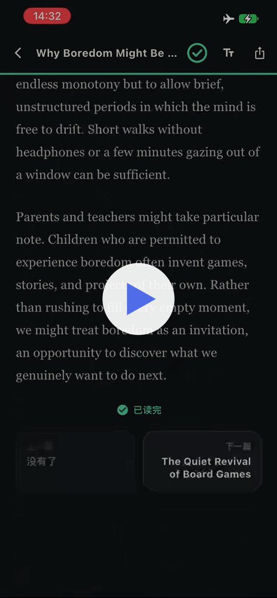
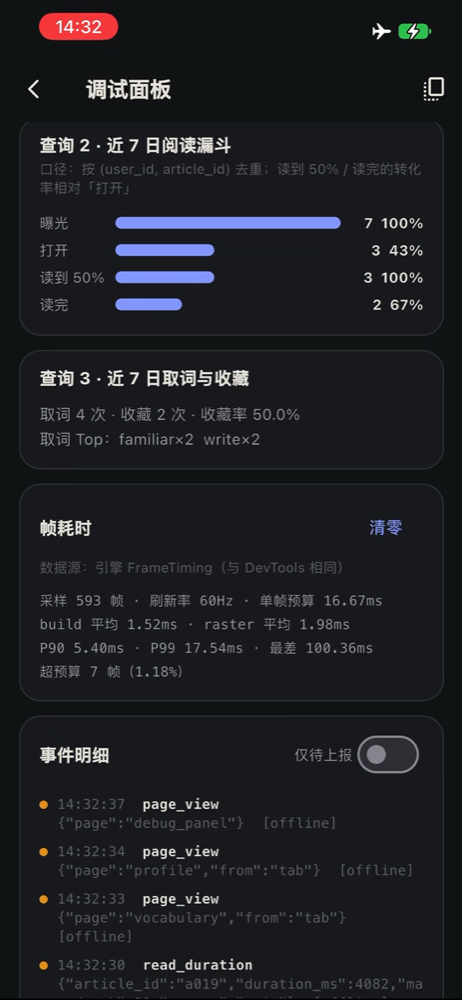
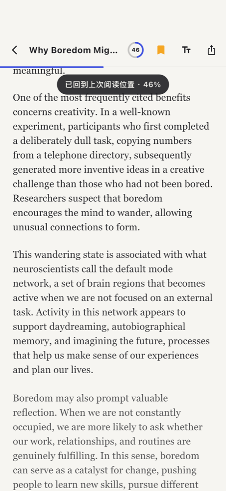
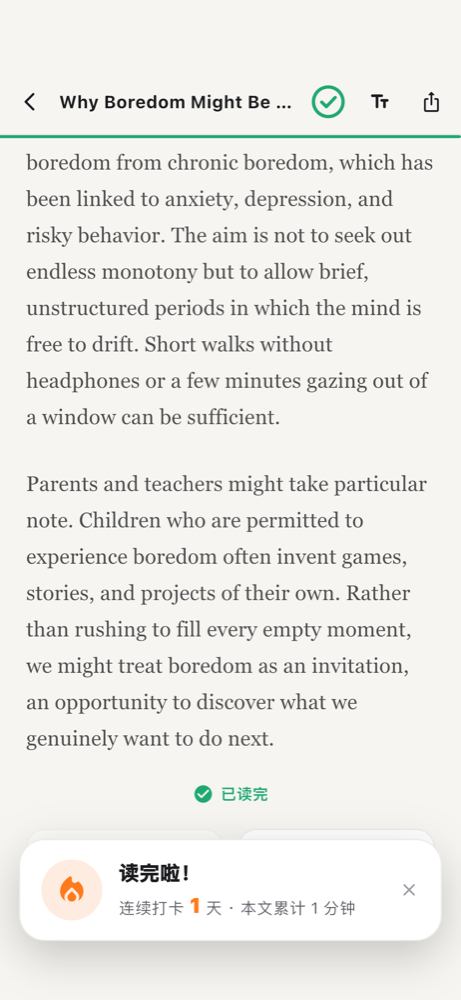
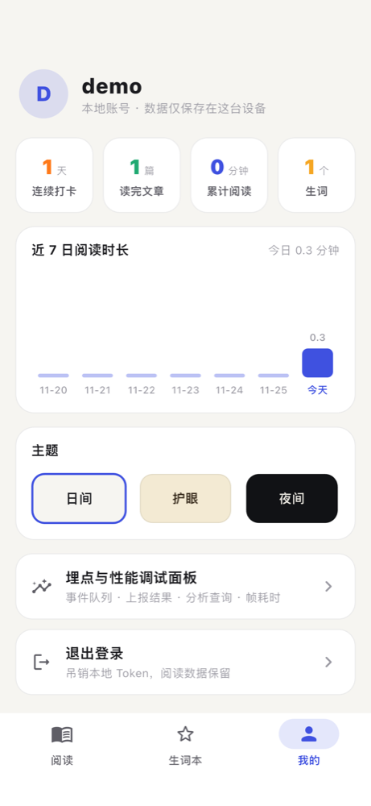
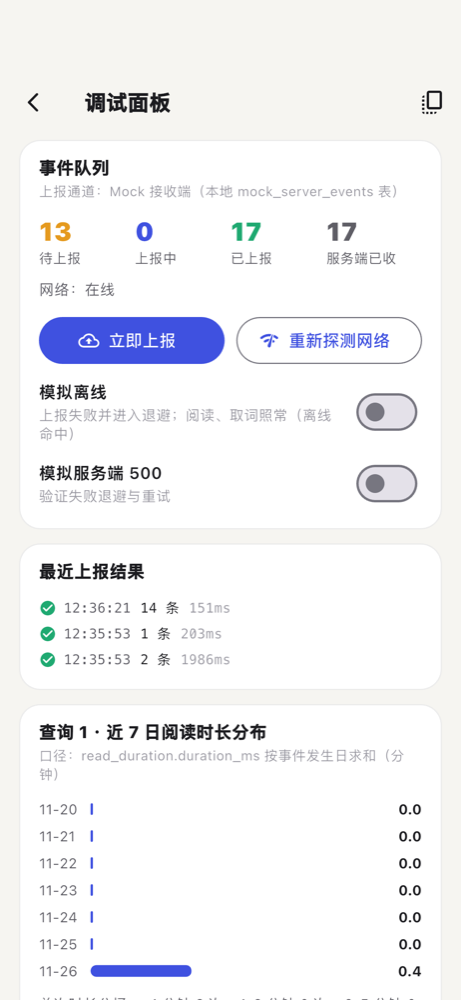

# English Reader

离线优先的英语阅读学习 App（Flutter）。数据全部存放在本地 SQLite，飞行模式下可以完成
「列表 → 阅读 → 长按取词收藏 → 进度落库」整条链路。

> 跨平台 App 工程师（数据分析方向）技术评估作业。数据层采用题目方案 ①：内置种子数据 + 本地 SQLite，不建后端；
> 同步与冲突策略见[第 7 节](#7-离线优先与数据一致性)。

## 目录

1. [演示素材](#1-演示素材)
2. [功能对照](#2-功能对照)
3. [本地启动](#3-本地启动)
4. [架构说明](#4-架构说明)
5. [技术选型与理由](#5-技术选型与理由)
6. [本地数据库](#6-本地数据库)
7. [离线优先与数据一致性](#7-离线优先与数据一致性)
8. [Mock 鉴权的校验方式](#8-mock-鉴权的校验方式)
9. [动效清单](#9-动效清单)
10. [三个技术难点](#10-三个技术难点)
11. [帧率验证](#11-帧率验证)
12. [数据埋点方案](#12-数据埋点方案)
13. [工程化](#13-工程化)
14. [打包、签名与上架](#14-打包签名与上架)
15. [已知缺陷与优化思路](#15-已知缺陷与优化思路)

---

## 1. 演示素材

### 真机录屏（iPhone 14 · iOS 27.2.1 · profile 模式）

<table>
<tr>
<td align="center"><a href="docs/videos/EnglishReaderDemo.mp4"></a><br><b>完整操作演示</b>（2 分 18 秒）<br>共享元素转场 · 手势返回 · 长按取词 · 读完庆祝</td>
<td align="center"><a href="docs/videos/EnglishReaderDemo_offline.mp4"></a><br><b>飞行模式离线演示</b>（47 秒）<br>离线阅读 · 进度落库 · 埋点离线缓存</td>
<td align="center"><br><b>飞行模式下的首页</b><br>继续阅读 · 打卡 · 读完标记</td>
<td align="center"><br><b>真机帧耗时</b><br>见<a href="#11-帧率验证">第 11 节</a></td>
</tr>
</table>

点击封面打开视频文件。

### 功能截图

以下截图由端到端测试在 iOS 模拟器上自动截取（登录页为真机截图）。图中的十字圆圈是测试框架画的触点标记，不属于 App 界面。

<table>
<tr><td align="center"><br>登录</td><td align="center"><br>文章列表</td><td align="center"><br>Tab 指示器滑动中</td><td align="center"><br>共享元素飞行中</td></tr>
<tr><td align="center"><br>阅读页</td><td align="center"><br>长按取词</td><td align="center"><br>收藏按钮弹跳</td><td align="center"><br>阅读中（进度环 / 进度条）</td></tr>
<tr><td align="center"><br>跟手右滑返回</td><td align="center"><br>继续阅读与卡片进度环</td><td align="center"><br>重进后恢复位置</td><td align="center"><br>读完：彩纸</td></tr>
<tr><td align="center"><br>读完：打卡卡片</td><td align="center"><br>生词本</td><td align="center"><br>跳回原文并高亮</td><td align="center"><br>我的</td></tr>
<tr><td align="center"><br>埋点调试面板</td><td></td><td></td><td></td></tr>
</table>

## 2. 功能对照

| 题目要求 | 实现 | 代码位置 |
|---|---|---|
| 登录 / 注册、Token 鉴权、登录态持久化 | 本地 Mock 账号 + HMAC 签名 Token，重启自动恢复 | `lib/data/auth_service.dart` |
| 列表：分类、难度、下拉刷新、分页、骨架屏 | 4 个分类 × 3 档难度，每页 8 篇，按需构建 | `lib/features/articles/` |
| 阅读：排版、主题、上下篇 | 字号 15–26、行距 1.4–2.1，日间 / 护眼 / 夜间 | `lib/features/reader/` |
| 阅读进度：位置、完成、时长、精确恢复 | 记录「段落序号 + 段内比例」，改字号后仍能回到同一句话 | `lib/domain/reading_math.dart` |
| 生词本：长按取词、查看、删除、跳回原文 | 取词即查本地词表；生词记录出处的段落与词序号 | `lib/features/reader/paragraph_view.dart` |
| 离线优先：SQLite 建表、种子导入 | 首次启动导入 24 篇文章和 1973 个词条 | `lib/core/db/` |
| 数据一致性：写入幂等、杀进程不丢 | 以绝对值快照写入，开启 WAL，最多丢失 0.8 秒 | `lib/data/progress_repository.dart` |
| 动效 4 项 | 全部完成 | `lib/motion/` |
| 埋点方案（加分项） | 事件模型、本地队列、退避重试、调试面板、3 个分析查询 | `lib/analytics/` |
| Git + CI | GitHub Actions：格式检查、静态分析、单元测试 | `.github/workflows/ci.yml` |

未做的加分项：小程序 / H5、推送与每日提醒、全文搜索、LLM 接入。

## 3. 本地启动

### 演示账号：`demo` / `demo1234`

登录页点「填入演示账号」可自动填入，也可以自己注册新账号。

**不需要后端，也不需要手动导入数据**：首次启动时，App 会在一个事务里把 `assets/seed/` 下的文章和词表导入 SQLite。

### 环境

- Flutter 3.50.x（Dart 3.14）
- iOS：Xcode 16.2 及以上，CocoaPods
- Android：Android SDK，JDK 17
- 国内网络先设置镜像：

```bash
export PUB_HOSTED_URL=https://pub.flutter-io.cn
export FLUTTER_STORAGE_BASE_URL=https://storage.flutter-io.cn
```

### 模拟器

```bash
flutter pub get
flutter run -d <设备 ID>          # 用 flutter devices 查看设备 ID
```

### iOS 真机

1. 用 Xcode 打开 `ios/Runner.xcworkspace`，在 Runner → Signing & Capabilities 里选择自己的 Team（免费个人账号即可）。
2. Xcode 支持手机的系统版本时，直接运行：`flutter run -d <设备 ID> --profile`
3. 手机系统比 Xcode 新时，Xcode 无法挂载调试器，需要先打 profile 包，再用系统命令安装：

   ```bash
   flutter build ios --profile
   xcrun devicectl device install app --device <设备 ID> build/ios/iphoneos/Runner.app
   ```

   第一次打开前，在手机上进入「设置 → 通用 → VPN 与设备管理」信任开发者。
   本仓库的真机录屏就是用这种方式安装的。

### 可选参数

- `--dart-define=ANALYTICS_ENDPOINT=https://…`：埋点改为真实 HTTP 上报（默认是本地 Mock 接收端）。
- `--dart-define=PERF_OVERLAY=true`：显示 Flutter 性能浮层。

### 测试

```bash
flutter analyze && flutter test          # 静态分析与 52 个单元测试
tool/analytics_report.sh                 # 对模拟器里 App 的数据库运行埋点分析查询
flutter drive --driver=test_driver/integration_test.dart \
  --target=integration_test/app_flow_test.dart -d <设备 ID>   # 端到端主链路，截图输出到 build/screenshots/
```

## 4. 架构说明

```
features/   页面：auth · articles · reader · vocabulary · profile · debug
motion/     动效组件：路由、入场、微光、进度环、彩纸…
────────────────────────────────────────────────────────────
domain/     纯逻辑（不依赖 Flutter 和 IO）：分词 · 阅读位置换算 · 有效时长 · 打卡
analytics/  埋点：事件模型 · 队列 · 上报器 · 会话 · 曝光 · 分析查询
────────────────────────────────────────────────────────────
data/       仓储：每张表一个，封装全部 SQL
core/db/    开库 · 迁移 · 种子导入 → SQLite（WAL）
```

- **依赖单向向下**。`domain/` 不依赖 Flutter，阅读位置、计时、打卡等核心算法都用纯单元测试覆盖。
- **状态管理**：SQLite 是唯一的数据来源。`AppScope` 在冷启动时组装所有仓储和服务，页面直接查询仓储。仓储在数据变化时递增 `revision`，监听它的页面重新查询。例如从阅读页返回后，列表卡片上的进度环会补间到新值。
- **冷启动顺序**：开库并迁移 → 导入种子（仅首次）→ 词表载入内存 → 校验 Token、恢复登录态 → 记录 `app_open` → 补报上次遗留的事件。

### 数据流

```
滚动 → 计算阅读位置与进度 → 节流 800ms 生成绝对值快照
     → 一个事务写入 reading_progress + reading_sessions → revision++ → 其它页面重新查询

用户行为 → Analytics.track（补齐公共参数，写入 event_queue，立即返回）
        → EventUploader 取批上报 → 成功标记已上报 / 失败按指数退避重试
```

### 表关系

```
users 1─n sessions
users 1─n reading_progress n─1 articles
users 1─n reading_sessions n─1 articles
users 1─n vocabulary       n─1 articles     （生词 → 原文出处）
dictionary 1─n dictionary_forms              （running → run）
event_queue 独立；upload_log 按 batch_id 关联一次上报
```

## 5. 技术选型与理由

| 层 | 选择 | 理由 |
|---|---|---|
| 跨端框架 | Flutter 3.50 | 自绘引擎，动效在 iOS 和 Android 上表现一致；手势、物理模拟、CustomPainter 都由框架原生提供，适合对手感要求高的场景 |
| 本地存储 | `sqflite`，手写 SQL | 题目要求给出建表 SQL 和迁移策略；手写 SQL 可以精确控制索引和幂等写法 |
| KV | SQLite 里的 `meta` 表 | 只需存阅读设置、种子版本、设备 ID 这几项，不值得再引入一个原生 KV 插件 |
| 安全存储 | `flutter_secure_storage` | Token 和签名密钥存放在 Keychain / Keystore |
| 状态管理 | 仓储 + `ValueNotifier` | 以 SQLite 为唯一数据源时，这种方式比引入 Riverpod / Bloc 少一层间接 |
| 动效 | 框架原生能力：`AnimationController`、`SpringSimulation`、`Hero`、`CustomPainter`、`Ticker` | 全部动效自行编排，没有使用 Lottie、Rive 或动效库 |
| 测试 | `flutter_test` + `sqflite_common_ffi` | 单元测试直接运行真实的 SQLite，执行与 App 相同的建表脚本 |

运行时的第三方依赖只有 4 个：`sqflite`、`path`、`flutter_secure_storage`、`crypto`。

## 6. 本地数据库

完整建表脚本见 [`lib/core/db/migrations.dart`](lib/core/db/migrations.dart)，下面列出核心表。

```sql
CREATE TABLE reading_progress (               -- 每个用户每篇文章一行
  user_id TEXT NOT NULL, article_id TEXT NOT NULL REFERENCES articles(id),
  paragraph_index  INTEGER NOT NULL DEFAULT 0, -- 读到第几段
  paragraph_offset REAL    NOT NULL DEFAULT 0, -- 段内纵向比例 0~1
  progress REAL NOT NULL DEFAULT 0, max_progress REAL NOT NULL DEFAULT 0,
  completed INTEGER NOT NULL DEFAULT 0, completed_at INTEGER,
  duration_ms INTEGER NOT NULL DEFAULT 0, last_read_at INTEGER NOT NULL,
  version INTEGER NOT NULL DEFAULT 1, updated_at INTEGER NOT NULL,
  PRIMARY KEY (user_id, article_id)
);

CREATE TABLE vocabulary (                     -- 同一用户的同一词元只收藏一次，记录首次出处
  id TEXT PRIMARY KEY, user_id TEXT NOT NULL,
  word TEXT NOT NULL, display TEXT NOT NULL,  -- 词元（小写）/ 原文中的写法
  phonetic TEXT NOT NULL DEFAULT '', pos TEXT NOT NULL DEFAULT '', meaning TEXT NOT NULL DEFAULT '',
  article_id TEXT NOT NULL, paragraph_index INTEGER NOT NULL, word_index INTEGER NOT NULL,  -- 出处
  context TEXT NOT NULL DEFAULT '', created_at INTEGER NOT NULL,
  version INTEGER NOT NULL DEFAULT 1, updated_at INTEGER NOT NULL,
  UNIQUE (user_id, word)
);

CREATE TABLE event_queue (                    -- 埋点队列；status：0 待上报 1 上报中 2 已上报
  event_id TEXT PRIMARY KEY, name TEXT NOT NULL, ts INTEGER NOT NULL,
  session_id TEXT NOT NULL, user_id TEXT NOT NULL DEFAULT '', payload_json TEXT NOT NULL,
  status INTEGER NOT NULL DEFAULT 0, attempts INTEGER NOT NULL DEFAULT 0,
  next_retry_at INTEGER NOT NULL DEFAULT 0, batch_id TEXT, sent_at INTEGER, last_error TEXT
);
```

其余的表：
- `articles`：正文以段落数组形式存放；
- `reading_sessions`：按天统计阅读时长和打卡；
- `users`、`sessions`：Mock 鉴权；
- `dictionary`、`dictionary_forms`：词表和词形还原；
- `upload_log`：上报结果记录；
- `mock_server_events`：扮演服务端；
- `meta`：键值存储。

| 索引 | 服务的查询 |
|---|---|
| `articles(category, published_at DESC, id)`、`articles(published_at DESC, id)` | 列表按分类或全部分页、上一篇 / 下一篇 |
| `articles(difficulty)` | 难度筛选 |
| `reading_progress(user_id, last_read_at DESC)` | 继续阅读 |
| `reading_sessions(user_id, day)` | 近 7 日阅读时长、打卡天数 |
| `vocabulary(user_id, created_at DESC)` | 生词本列表 |
| `event_queue(status, next_retry_at, ts)` | 上报器取批 |
| `event_queue(name, ts)` | 分析查询 |

**迁移策略。** 版本号存放在 `PRAGMA user_version`。打开数据库时依次执行未执行过的版本脚本，整个过程在一个事务里，失败则整体回滚、版本号不前进。已发布的脚本只增不改。单元测试覆盖了 v1 → v2 的升级路径。

## 7. 离线优先与数据一致性

**幂等写入。** 阅读进度每次写入的都是**绝对值快照**，而不是增量：

```sql
UPDATE reading_progress SET
  paragraph_index = ?, paragraph_offset = ?, progress = ?,
  max_progress = MAX(max_progress, ?),        -- 最远进度不回退
  completed    = MAX(completed, ?),           -- 完成状态不回退
  completed_at = COALESCE(completed_at, ?),   -- 首次读完时间不被覆盖
  duration_ms  = MAX(duration_ms, ?),         -- 时长是绝对值，重复写入不会累加
  last_read_at = MAX(last_read_at, ?), version = version + 1, updated_at = ?
WHERE user_id = ? AND article_id = ?;         -- 未命中时 INSERT，与 UPDATE 在同一事务
```

同一份快照写 1 次和写 N 次结果相同，所以节流落库、切后台落库、离开页面落库可以放心地重叠触发。
没有用 `ON CONFLICT DO UPDATE`，是因为 Android 9 及以下系统自带的 SQLite 版本低于 3.24，不支持该语法。
其它写入同样幂等：生词依靠 `UNIQUE(user_id, word)`，事件依靠 `event_id` 主键，种子导入按主键 `REPLACE`。

**杀进程不丢进度。** 滚动时每 800ms 落库一次，另外每 5 秒心跳落库一次，App 切后台时立即落库。数据库开启 WAL，已提交的事务在进程被杀后仍然完整。因此任意时刻杀进程，最多丢失最近 0.8 秒的滚动位置。

**接入后端时的同步与冲突策略（只有设计，未实现）。** 可变表都预留了 `version` 和 `updated_at` 字段：

- **上行**：本地改动写入与 `event_queue` 同构的变更日志表，复用同一套「取批 → 上报 → 退避重试」机制，服务端按变更 ID 去重。
- **阅读进度**：按字段合并。`max_progress`、`completed`、`duration_ms` 取两端的较大值（满足交换律，可以安全重放）；当前位置按 `last_read_at` 采用 last-write-wins。
- **生词本**：按集合语义合并，新增取并集；删除记墓碑（`deleted_at`），与新增按时间戳比较。
- **文章**：只读数据，按服务端 `version` 单向下行覆盖。

## 8. Mock 鉴权的校验方式

- **密码**：16 字节随机盐 + SHA-256 迭代 2000 轮，不存明文。
- **Token**：`base64url(payload).base64url(HMAC-SHA256(payload, secret))`，结构与 JWT 相同。payload 包含 `sub`、`jti`、`iat`、`exp`（30 天）；`secret` 在安装时随机生成，存放在 Keychain / Keystore。
- **校验**：冷启动时执行，以下四项全部通过才恢复登录态：
  1. 签名正确（常数时间比较）；
  2. 未过期；
  3. `sessions` 表中存在该 `jti` 且未被吊销；
  4. 用户存在。
- **登出**：吊销 `jti` 并删除本地 Token，旧 Token 立即失效。

单元测试覆盖：重启恢复、篡改 Token、Token 过期、登出后失效、错误密码、重复注册。

## 9. 动效清单

所有参数集中在 [`lib/motion/motion.dart`](lib/motion/motion.dart)。弹簧的阻尼比 ζ = damping / (2·√(stiffness·mass))，ζ < 1 时会回弹。

| 弹簧 | mass / stiffness / damping | ζ | 用途 |
|---|---|---|---|
| `snappy` | 1 / 420 / 34 | 0.83 | 跟手交互的收尾，如返回手势取消后的回弹 |
| `bouncy` | 1 / 380 / 18 | 0.46 | 强调型反馈：取词气泡、庆祝卡片 |
| `gentle` | 1 / 200 / 25 | 0.88 | 大面积元素落定，如卡片按压后的回弹 |

| # | 动效 | 页面 | 方案 | 关键参数 |
|---|---|---|---|---|
| 1 | 封面共享元素 | 列表卡片 → 阅读页头图 | `Hero` + 自定义 shuttle | 直线飞行；圆角 14 → 0 随进度插值；封面为矢量绘制，放大不糊 |
| 1 | 标题共享元素 | 同上 | `Hero`，飞行中不重排文字 | 两端排版各自冻结后按宽度缩放叠放；列表侧在 0–45% 淡出，详情侧在 20–70% 淡入 |
| 1 | 页面转场 | 全局 | 自定义 `PageRoute` | 进入 460ms、返回 380ms；下层页面视差左移 25% 并压暗 16% |
| 1 | 跟手右滑返回 | 阅读页等二级页面 | 自定义手势，直接改写路由动画进度 | 全屏宽度都可发起；松手速度 ≥ 1 屏宽 / 秒时按方向判定，否则看是否过半；取消时用 `snappy` 带松手速度回弹 |
| 2 | 列表交错入场 | 文章列表、生词本 | `StaggerController` | 每项延迟 55ms（最多 10 级），420ms，淡入 + 上移 22px；滚动后才构建的卡片不排队，已入场的卡片不重播 |
| 2 | 正文首屏入场 | 阅读页 | 单个控制器驱动多个区块 | 转场开始 160ms 后启动，每块延迟 70ms，淡入 + 上移 18px |
| 3 | 进度条 / 进度环 | 阅读页顶栏 | 由滚动位置逐帧驱动，`CustomPainter` | 无补间，不会滞后；读完后进度环闭合，用 520ms 描出对勾 |
| 3 | 卡片进度环 | 文章列表 | `TweenAnimationBuilder` | 数值变化时 600ms 推进到新值 |
| 3 | 读完庆祝 | 阅读页 | 自绘粒子系统（1 个 `Ticker` + 1 个 `CustomPainter`）+ 打卡卡片 | 110 片彩纸，初速度 900–1700 px/s，重力 1500 px/s²，3.2 秒；打卡天数做数字滚动；触发一次重触感 |
| 4 | 收藏按钮形变弹跳 | 取词气泡 | 620ms 编排 + 放射粒子 | scaleX 1 → 1.25 → 0.82 → 1，scaleY 1 → 0.70 → 1.32 → 1，最后用 `elasticOut` 落定 |
| 4 | Tab 指示器滑动 | 文章列表 | 实测 Tab 位置，自绘胶囊 | 360ms；前缘在 0–65% 先走、后缘在 35–100% 后走，中途被拉长；胶囊下方的文字反色 |
| 4 | 骨架屏微光 | 文章列表 | 整块骨架共用一个 `ShaderMask` | 1.3 秒一个周期 |
| 4 | 其它 | 各页面 | 取词气泡弹出、按压缩放、登录错误抖动、主题颜色补间 | 弹簧缩放 0.82 → 1、按下缩放到 0.97、衰减正弦 420ms、主题补间 260ms |

**性能取舍。** 入场、按压、转场只修改 `Opacity` 和 `Transform`，不触发布局。彩纸、进度环、指示器、取词高亮都用 `CustomPainter` 实现，每帧只绘制一次，不重建 Widget。骨架屏整块只有一个着色器。阅读页顶栏局部重建，滚动时正文不重建。

**验证方式。** 端到端测试 `integration_test/app_flow_test.dart` 会依次触发上述动效，并在动画中途截图（见第 1 节）。帧率数据见第 11 节。

## 10. 三个技术难点

**1. 退出重进时精确恢复阅读位置。** 不存像素，存「段落序号 + 段内纵向比例」。像素偏移在改字号或换设备后就会失效，「第 3 段的 37% 处」则始终指向同一句话。

- 布局完成后，实测每个段落槽位（段落加段后间距）的位置。
- 滚动时把阅读线所在位置换算成上述二元组落库。
- 重进时等转场结束，再换算回当前排版下的像素偏移并滚动过去。
- 改字号时，先记下当前位置，重排后再跳回同一位置。

测量的是入场动画 `Transform` 之外的槽位。最初直接测量段落，结果被入场位移带偏了 18px，这个问题是端到端测试里「字号还原后偏移应还原」的断言发现的。目前端到端测试验证：重进后的偏移误差不超过 1px。

**2. 长按取词。** 整段只用一个 `RichText`，而不是每个单词一个 Widget。

- 长按位置通过 `getPositionForOffset` 得到字符偏移，再在预先分好的词表中二分查找所属单词。
- 用 `getBoxesForSelection` 取得单词包围盒，并校验手指确实落在盒内，避免行尾空白也吸附到最近的单词。
- 高亮由 `CustomPainter` 画在文字下层，换词时只重绘，不重排。
- 长按后不抬手继续拖动，可以连续换词。

词表在启动时载入内存，取词是同步查找。单元测试校验了内置文章中的每个词都能查到释义。生词记录的 `(文章, 段落, 词序号)` 与排版无关，所以「跳回原文」在任何字号下都能定位并高亮。

**3. 跟手返回与共享元素联动。**

- 手势被判定为横向后调用 `navigator.didStartUserGesture()`，`HeroController` 随之启动由手势驱动的飞行。
- 拖动时直接改写路由的动画进度，页面位移、视差、遮罩和 Hero 飞行都由这一个值驱动。
- 手势期间采用线性映射，保证页面跟手；非手势转场才套用缓动曲线。
- 封面滚出屏幕后用 `HeroMode` 关闭共享元素，避免返回时封面从屏幕外飞回卡片。
- 返回手势在手势竞技场中与纵向滚动、长按取词公平竞争，不影响上下滚动。

## 11. 帧率验证

**真机数据。** 设备为 iPhone 14（iOS 27.2.1，60 Hz），profile 模式，飞行模式下一段连续操作（列表、阅读、生词本、我的）的累计结果，可在离线演示录屏第 34 秒看到：

| 采样 | 单帧预算 | build 平均 | raster 平均 | P90 | P99 | 最差 | 超预算 |
|---|---|---|---|---|---|---|---|
| 593 帧 | 16.67 ms | 1.52 ms | 1.98 ms | 5.40 ms | 17.54 ms | 100.36 ms | 7 帧（1.18%） |

这里的耗时指单帧 build 与 raster 之和。98.8% 的帧在预算内，平均耗时不到预算的四分之一。个别超预算的帧推测出现在页面首次构建时（例如第一次进入某个 Tab），尚未逐帧定位，优化思路见第 15 节。

**测量方法。**
- **App 内调试面板**（我的 → 埋点与性能调试面板 → 帧耗时）：数据来自引擎的 `FrameTiming`，与 DevTools 同源。先点「清零」，操作完再回来查看；右上角可以复制结果。
- **自动采集**：端到端测试用 `watchPerformance` 包住了列表滚动、共享元素转场、手势返回、读完庆祝 4 个场景。在支持调试的真机上加 `--profile` 运行，结果写入 `build/integration_response_data.json`。

debug 模式和模拟器的数据没有参考价值：debug 模式包含断言且使用 JIT 执行，iOS 模拟器使用软件渲染。

## 12. 数据埋点方案

### 事件模型

**命名规范**：`对象_动作`，全小写加下划线。新事件必须先在 [`event_schema.dart`](lib/analytics/event_schema.dart) 登记；debug 模式下会校验必填参数和未登记参数，单元测试会校验所有事件名符合规范。

**公共参数**（自动附带）：`event_id`（UUID，去重键）· `event` · `ts` · `device_id` · `user_id` · `session_id` · `app_version` · `platform` · `network`（事件发生时在线还是离线）。

| 事件 | 触发位置 | 必填参数 | 选填参数 |
|---|---|---|---|
| `app_open` | 冷启动；后台超过 30 秒后回到前台 | `launch_type` | `background_ms` |
| `session_start` | 新会话开始 | `reason` | |
| `page_view` | 进入页面、切换 Tab | `page` | `from`、`article_id` |
| `user_login` | 登录 / 注册成功 | `method` | |
| `list_refresh` | 下拉刷新 | | `category`、`difficulty` |
| `category_switch` | 分类 / 难度切换 | `filter_type`、`to` | `from` |
| `article_expose` | 列表卡片曝光 | `article_id`、`position` | `category`、`difficulty`、`list_category` |
| `article_open` | 打开文章 | `article_id`、`source` | `category`、`difficulty`、`resume_progress` |
| `read_progress` | 滚动深度首次达到 25 / 50 / 75 / 100 | `article_id`、`depth` | |
| `read_duration` | 离开阅读页或切后台 | `article_id`、`duration_ms`、`max_depth` | `reason` |
| `article_finish` | 首次读完 | `article_id`、`total_duration_ms` | `streak_days`、`category`、`difficulty` |
| `word_lookup` | 长按取词 | `article_id`、`word` | `found`、`paragraph_index` |
| `word_collect` / `word_remove` | 收藏 / 删除生词 | `article_id`、`word` / `word` | `paragraph_index`、`source` |
| `article_share` | 分享 | `article_id` | `channel` |
| `offline_hit` | 无网络时由本地库提供列表或文章 | `resource` | `article_id` |
| `reader_setting_change` | 调整字号 / 行距 / 主题 | `key`、`value` | |

### 上报策略

- **入队**：`track()` 只写入 `event_queue` 后立即返回，不发起网络请求，不阻塞 UI。
- **触发上报**：冷启动、每 30 秒、待上报满 20 条、App 切后台、调试面板手动触发。
- **取批**：在一个事务内取出最多 20 条，并标记为「上报中」。
  - 成功：标记为「已上报」，写入 `upload_log`。
  - 失败：退回「待上报」，等待 5s × 2^(n−1) 后重试，最长 10 分钟，并加 ±20% 随机抖动。
- **离线缓存**：离线期间 `track` 照常记录，事件留在队列里。
- **冷启动补报**：先把上次卡在「上报中」的事件退回「待上报」，再立即上报。
- **幂等**：客户端以 `event_id` 主键防止重复入队；重发的事件由服务端按 `event_id` 去重。Mock 接收端实现了这一去重，单元测试验证了重发后服务端没有重复数据。
- **清理**：已上报的事件保留 30 天，用于本地查询。

### 统计口径

| 指标 | 口径 |
|---|---|
| 会话 | 冷启动开启新会话；后台超过 30 秒后回到前台算新会话 |
| 阅读时长 | 只计阅读页在前台可见、且最近 60 秒内有滚动或触摸的时间；后台时间不计 |
| 滚动深度 | 滚动偏移 ÷ 可滚动总长；达到 97% 视为读完 |
| 曝光 | 可见面积 ≥ 50% 且连续停留 ≥ 500ms；同一会话内同一篇文章只上报一次 |
| 打卡 | 当天有效阅读 ≥ 30 秒或读完过文章；连续打卡从今天往前数，今天还没读时从昨天开始数 |

### 验证方式

- **调试面板**：可查看待上报 / 上报中 / 已上报数量、Mock 服务端实际收到的数量、最近上报结果、事件明细（含联网状态和重试次数）、3 个查询的实时结果；提供「模拟离线」「模拟服务端 500」开关和「立即上报」按钮。离线演示录屏里能看到飞行模式下上报失败、事件标记为 `[offline]` 并进入退避。
- **日志**：`flutter logs | grep '\[analytics\]'`
- **汇总脚本**：`tool/analytics_report.sh`，直接对 App 的 SQLite 数据库执行下面的查询。

### 分析查询

```sql
-- 查询 1：近 7 日阅读时长（分钟 / 天）
SELECT date(ts/1000, 'unixepoch', 'localtime') AS day,
       ROUND(SUM(json_extract(payload_json, '$.props.duration_ms')) / 60000.0, 1) AS minutes
FROM event_queue WHERE name = 'read_duration' AND ts >= :since GROUP BY day;

-- 查询 2：曝光 → 打开 → 读到 50% → 读完 漏斗，按 (user_id, article_id) 去重
WITH e AS (SELECT name, user_id || '|' || json_extract(payload_json, '$.props.article_id') AS k,
                  json_extract(payload_json, '$.props.depth') AS depth
           FROM event_queue WHERE ts >= :since),
     opened AS (SELECT DISTINCT k FROM e WHERE name = 'article_open')
SELECT (SELECT COUNT(DISTINCT k) FROM e WHERE name IN ('article_expose', 'article_open')) AS exposed,
       (SELECT COUNT(*) FROM opened) AS opened,
       (SELECT COUNT(DISTINCT k) FROM e WHERE name = 'read_progress' AND depth >= 50 AND k IN opened) AS half,
       (SELECT COUNT(DISTINCT k) FROM e WHERE name = 'article_finish' AND k IN opened) AS finished;

-- 查询 3：取词收藏率
SELECT SUM(name = 'word_lookup') AS lookups, SUM(name = 'word_collect') AS collects
FROM event_queue WHERE name IN ('word_lookup', 'word_collect') AND ts >= :since;
```

**示例输出一**：真机调试面板（离线演示录屏第 34 秒）。

```
阅读漏斗   曝光 7 → 打开 3（43%）→ 读到 50% 3（100%）→ 读完 2（67%）
取词收藏   取词 4 次 · 收藏 2 次 · 收藏率 50.0% · Top：familiar×2  write×2
```

**示例输出二**：模拟器上跑完端到端测试后，`tool/analytics_report.sh` 的输出（节选）。

```
== 事件队列 ==            pending 11 · sent 19
== 查询 1 ==              2026-11-26  0.4 分钟  3 次阅读
== 查询 2 ==              exposed 4 · opened 1 · half 1 · finished 1
== 查询 3 ==              lookups 1 · collects 1 · collect_rate 100.0%
== 最近上报 ==            12:39:04 16 条 ok 253ms · 12:38:36 1 条 ok 282ms
```

App 内为兼容没有 JSON1 扩展的旧版 Android 系统 SQLite，采用「SQL 按索引取行 + Dart 聚合」的实现，口径与上面的 SQL 一致，由 `test/analytics_test.dart` 中的固定数据集锁定。

## 13. 工程化

- **Git**：按「工程骨架 → 数据库 → 领域逻辑 → 数据层 → 埋点 → 动效 → 页面 → 测试 → CI → 文档」分步提交。
- **CI**（`.github/workflows/ci.yml`）：push / PR 时依次执行 `dart format --set-exit-if-changed`、`flutter analyze --fatal-infos`、`flutter test`。
- **测试**：52 个单元测试 + 1 个端到端主链路测试。

| 测试文件 | 覆盖 |
|---|---|
| `test/domain_test.dart` | 分词、阅读位置换算（含改字号）、深度里程碑、打卡、有效阅读时长 |
| `test/data_test.dart` | 迁移升级、种子导入幂等、分页与上下篇、进度幂等 / 不回退 / 杀进程恢复、生词去重、鉴权 |
| `test/analytics_test.dart` | 事件模型、入队幂等、分批、退避重试、离线补报、冷启动补报与去重、会话切分、3 个查询 |
| `test/seed_data_test.dart` | 种子数据结构合法、可导入、词表覆盖正文中的每个词 |
| `integration_test/app_flow_test.dart` | 登录 → 转场 → 取词 → 位置恢复 → 改字号 → 读完 → 手势返回 → 跳回原文 → 埋点入队 |

## 14. 打包、签名与上架

**iOS（App Store）**

1. 在开发者后台创建 App ID（`com.rh541250.englishReader`），在 App Store Connect 创建 App。
2. Xcode 使用自动签名；CI 上用 App Store Connect API Key + `fastlane match` 管理证书和描述文件。
3. 递增 `pubspec.yaml` 中的构建号（`version: 1.0.0+N`），执行 `flutter build ipa --release --obfuscate --split-debug-info=build/symbols`。
4. 用 Transporter 或 `fastlane pilot` 上传，先走 TestFlight，再提交审核。审核备注里提供演示账号，并在 `PrivacyInfo.xcprivacy` 和隐私问卷中如实声明设备标识的收集。

**Android（应用商店）**

1. 用 `keytool` 生成上传密钥；`android/key.properties` 不入库，在 `build.gradle.kts` 的 `signingConfigs.release` 中引用。
2. Google Play 用 `flutter build appbundle --release --obfuscate --split-debug-info=build/symbols`，并开启 Play App Signing；国内商店用 `flutter build apk --release --split-per-abi`，另需准备软著、隐私政策和权限说明。
3. 归档 `build/symbols`，用于还原线上崩溃堆栈。

## 15. 已知缺陷与优化思路

**验证范围**
- iOS 已在模拟器（iPhone 16 / iOS 18.3）和真机（iPhone 14 / iOS 27.2.1，profile 模式）上验证。
- Android 工程已生成，代码中没有平台分支，但没有在本机构建和运行过。

**功能取舍**
- 没有后端与同步，冲突策略只有设计。
- 列表首次加载和下拉刷新加了 650ms 模拟延迟，用于展示骨架屏和刷新态。
- 分享只复制文案到剪贴板。封面是按文章 ID 生成的矢量图。
- 跨零点的一次阅读，时长全部计入开始那一天。
- 词表只保证覆盖内置文章。
- 正文一次性布局全部段落，适合两千词以内的文章；更长的文章需要改成懒加载，并用 `TextPainter` 预先计算段落高度。
- 国行 iOS 首次启动会弹出「允许使用无线数据」，起因是联网探测和埋点上报；拒绝后不影响离线阅读。

**后续优化**
- 定位真机上个别超过 16ms 的帧：把阅读页首屏构建拆到多帧，或对非首屏段落延迟构建。
- 取词放大镜、短语选择；生词本复习模式（间隔重复）。
- 用 SQLite FTS5 做全文搜索；本地通知做每日提醒。
